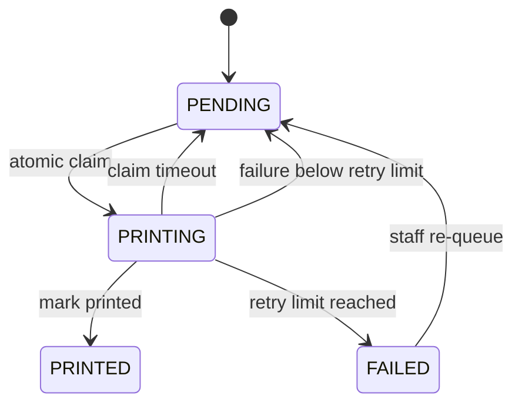

# CafeCorner design notes

## Coupon handling

Staff redeem coupons at the counter on a customer's behalf. Customers can list and view only coupons attached to their own orders. A successful redemption records the staff user and redemption time. The redemption endpoint is rate limited to reduce code guessing.

Coupon codes use 24 cryptographically random characters from an uppercase alphabet that omits ambiguous `0`, `O`, `1`, and `I` characters. Coupons expire 30 days after issuance by default; `COUPON_VALIDITY_DAYS` changes that period.

The order transition to `COLLECTED`, its status-history row, coupon issuance, and `COUPON_SLIP` print job share one database transaction. The transition uses a conditional update against the expected order status. Coupon redemption similarly updates only a matching, unused, unexpired code inside a transaction and checks the affected-row count.

The concurrent-redemption test simulates two callers that both observed the coupon as unused, then submits both conditional redemptions. The second attempt cannot update the row. This project uses SQLite for development; its coarse writer locks make threaded race tests unreliable, while the conditional-update behavior is the same database operation used on PostgreSQL.

## Dashboard dates

`Order.collected_at` is set during the `COLLECTED` transition and is used to decide which local day receives the revenue and top-item totals. `updated_at` continues to record any status transition, but later edits cannot move revenue between days. Dates use `TIME_ZONE = "Asia/Kolkata"` with `USE_TZ = True`. Dashboard summaries use database `COUNT` and `SUM` aggregation and include only `COLLECTED` orders in revenue and item sales.

## Printer jobs

`PrintJob` separates the order slip from the coupon slip. Order placement creates the first job; collecting an order creates its coupon slip in the same transaction as the status change and coupon. The printer token belongs to a non-staff `Printer` group user. It can list, claim, and complete print jobs, but other API permission classes reject it. Staff and admins use their session to re-queue a permanently failed job; the staff queue shows failures without exposing coupon codes.

Run `python manage.py create_printer_user` to create the dedicated user. The command displays its DRF token once, refuses to reveal it again on a later invocation, and does not make the user a Django admin or staff user.

A claim is an atomic conditional update from `PENDING` to `PRINTING` that sets `claimed_at`. Only a current `PRINTING` job can be marked printed or failed. After `PRINT_CLAIM_TIMEOUT_SECONDS` (120 seconds by default), a stale claim returns to `PENDING`. Each reported failure increments the server-owned retry count; below `PRINT_MAX_RETRIES` (3 by default), the job returns to `PENDING`. At the limit it stays `FAILED` until staff re-queues it, which resets that retry cycle.

`printer_client/` is standalone and uses only `requests` in console mode. It polls, claims, formats a receipt, prints through a backend, then reports success or failure. Network errors use capped exponential backoff; a single device or job error does not stop the loop. The console backend prints to the terminal and a text file. Thermal printing uses optional `python-escpos`; that backend has not been tested on real hardware.
