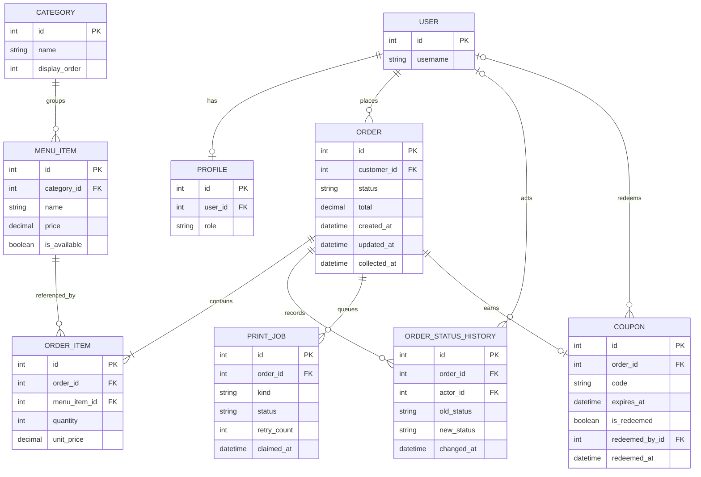
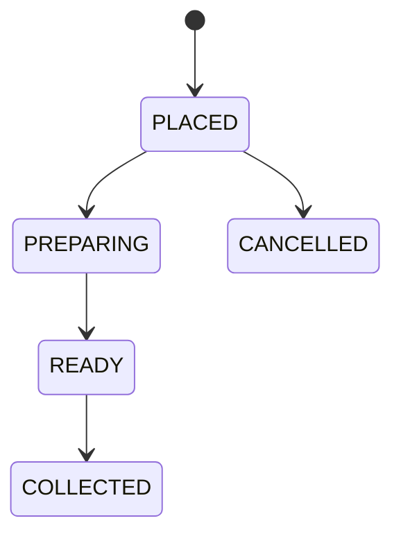
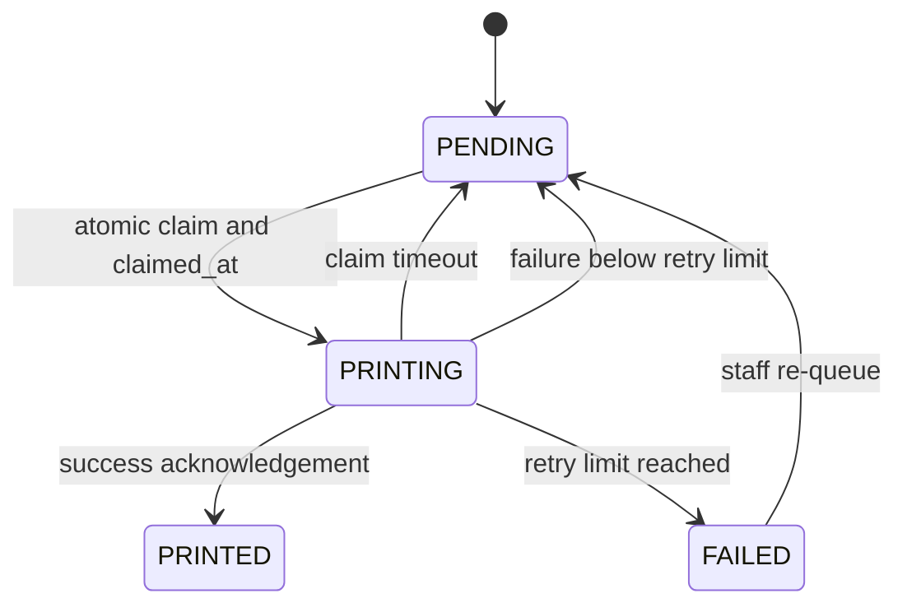

# CafeCorner design

## Local demo data

The cross-app `seed_demo` management command lives in the neutral `core` app. Run `python manage.py seed_demo` after migrations in a `DEBUG=True` local environment. It creates demo accounts, Indian cafe menu records, and sample orders idempotently, and refuses to run with debugging disabled.

## Data model

`OrderItem.unit_price` preserves the price at checkout even when the current menu price changes. `Order.collected_at` is the collection timestamp used by the dashboard; `updated_at` is for polling and changes on every status transition. All money is `DecimalField` data and server-side `Decimal` arithmetic.

## Order workflow and concurrency

The transition table lives on `Order.ALLOWED_TRANSITIONS`:

Each transition and its history row share a database transaction. State changes use a conditional update filtered by order ID and expected current status; a row count of zero means another request already changed it, so the API returns HTTP 409. This prevents two staff actions based on the same stale state from both succeeding. Collection also sets `collected_at` and creates the coupon and coupon print job within that transaction. Order placement validates current menu availability and price, creates price snapshots, and creates its order-slip job atomically.

## Print jobs

An order slip is queued at placement. A coupon slip is queued at collection, when its coupon exists. These are independent print jobs with independent status and retry history.

The printer client polls pending jobs, atomically claims one, formats the slip, prints, and reports success or failure. The server owns claim timeout and retry count. After three failures by default the job remains FAILED for staff review; staff requeue it to start another retry cycle. `PRINT_CLAIM_TIMEOUT_SECONDS` (default 120) releases a job abandoned by a crashed client.

The `Printer` group gets a dedicated DRF token user. Its permission class grants only print-job actions; menu, order, coupon, profile, and staff requeue actions reject that token. Staff/admin use their normal session or token for staff functions. Coupon codes are included in printer responses only for coupon-slip jobs and are excluded from order and staff queue responses.

## Coupon single use

Staff redeem at the counter on behalf of the customer; customers can list their own coupons. Codes have 24 random characters from an alphabet that omits ambiguous characters and expire after 30 days by default. Redemption performs one conditional update within `transaction.atomic()`, filtering on the code, `is_redeemed=False`, and `expires_at > now`. It checks that exactly one row changed before returning success, so two requests cannot both consume the same code. Errors are clear but do not reveal coupon existence to unauthenticated users; the endpoint is DRF-throttled.

The test simulates two callers observing the same unused coupon before either update. The first conditional update succeeds and the second affects zero rows. It verifies the conflict behavior of the atomic database operation, not true parallel scheduling under production traffic. SQLite locking makes a deterministic threaded race test unreliable; PostgreSQL should also be used for deployment and load testing.

## Permissions

| Role | Capabilities |
| --- | --- |
| Customer | Browse available menu items, place orders, view/cancel own PLACED orders, view own coupons |
| Staff | View and advance all active orders, redeem coupons, requeue failed print jobs |
| Admin | Staff capabilities, menu/category management, order history, dashboard |
| Printer | List/claim/complete print jobs only |

The API uses role/group permission classes. Customer data is scoped to the authenticated user. Printer identity is checked separately and is not a staff role. Web pages use the same group roles. Anonymous DRF requests commonly return 403 with the configured SessionAuthentication because it does not provide a `WWW-Authenticate` challenge.

## Polling and scale

The customer order page and staff queue poll with a small JSON response every few seconds and pause while the browser tab is hidden. Polling is easy to host, needs no persistent connection service, and is sufficient for this single-cafe demo. The optional `since` filter uses `updated_at`, so transitions to old orders are included.

At higher traffic, run Django behind multiple application workers with PostgreSQL, add indexes based on measured queries, and put the printer work behind a durable queue or use a broker-backed worker. WebSockets (for example, via Django Channels) can reduce idle polling if there are many connected clients, but add connection and broker operations. A multi-site deployment would also partition queue visibility and printer ownership by cafe location.

## Known limitations and future work

- SQLite is for local development; use PostgreSQL for production concurrency and operational reliability.
- Payments, refunds, tax, inventory, and order modification are not implemented.
- Polling is used instead of WebSockets; Channels or server-sent events may suit a larger deployment.
- Coupon rate limiting is configured globally by DRF scope; rate limiting per user/device/IP needs deployment-specific review.
- Order status history exists, but there is no complete audit log for menu edits, requeues, login events, or administrative changes.
- Thermal printer configuration and physical output need testing on actual hardware.
- Add location scoping, backups, monitoring, and load testing before operating multiple cafes.
